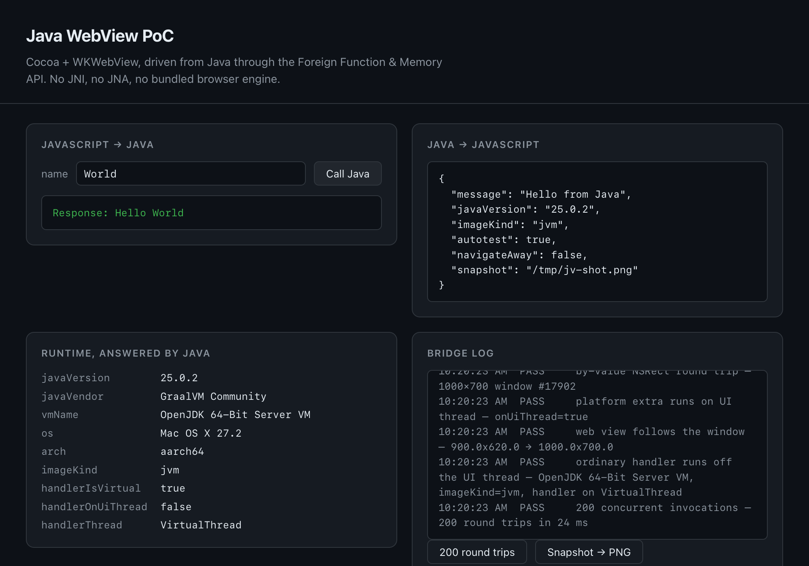

# panamaview

[](https://github.com/lihuu/panamaview/actions/workflows/ci.yml)

Drive the operating system's web view from Java over the FFM API. No JNI, no JNA, no shim
library and no bundled browser engine — everything crosses into Objective-C through
`java.lang.foreign`.

> **The name.** `java.lang.foreign`, the API this is built on, came out of OpenJDK's
> [Project Panama](https://openjdk.org/projects/panama/) — named after the canal that joined
> two oceans. Joining Java and native code is roughly the same trick.
>
> **Status.** macOS and Windows. No application outside this repository has been built on it yet,
> which is the one thing a framework cannot prove about itself — see
> [Not done](#not-done-deliberately) for the rest of the honest list.

**The Phase 1 acceptance criterion is met.** Both chains below run end to end, on the JVM
*and* as a GraalVM native executable:

```
Java → FFM → Cocoa → WKWebView → HTML/JS → JS→Java → Java→JS
```

The macOS chain above is the one this repository develops against. A second implementation lives
beside it in `panamaview.windows` — Win32, COM and WebView2, the same `UiHost` behind the same
portable framework — and the same chain has been run on Windows hardware:

```
Java → FFM → Win32/COM → WebView2 → HTML/JS → JS→Java → Java→JS
```

with the caveat that the last stretch of it was proved by hand rather than by CI. A project
generated from `templates/vanilla` was run unmodified on Windows 11 with JDK 25 and reached
`page loaded: url=https://app.panamaview/index.html` and a `java → js` message arriving in the page,
with nothing on stderr. What has *not* happened is that run being repeatable on demand: WebView2
refuses to start in a non-interactive session, so it needs a desktop and cannot be a CI job the way
the macOS check is. See [Keeping the platform isolated](#keeping-the-platform-isolated) for why the
second implementation could be added without touching the first.



<sub>A real window, photographed by the app itself through WebKit's snapshot API. The bridge log
is the self-test reporting: every `PASS` there is a check that would fail if the mechanism under
it were removed.</sub>

## Requirements

- macOS on Apple Silicon, or Windows x64
- JDK 25 with the FFM API
- GraalVM CE 25.0.2 (or any GraalVM with `native-image`) — only for the native build, and only on
  macOS today: the build script is POSIX shell and is not ported
- Maven

Verified on macOS 27.2 / arm64 and on Windows 11 build 26340 / x64 (an Insider Preview build — the
one machine this was tested on, not a claim about the released builds). Linux is next in line, and
nothing in the portable half is standing in its way: a `UiHost` for it is what is missing.

There are **no runtime dependencies**. FFM is the entire binding layer.

## Run the demo

There is nothing to launch in this directory, and that is the point: a library has no `main()`.
`demo-app/` is a small application that depends on `panamaview` the way anyone else would — one
dependency, its own sources, its own assets — and is also the acceptance test, because every
mechanism in the bridge has a probe there.

It is a module of this repository's reactor, but that does not make it less of a consumer: it still
resolves the framework out of the local Maven repository like anyone else, so install first.

```sh
mvn -q install                 # the framework and the demo — one reactor
cd demo-app
./run.sh                       # JVM mode; prints [selftest] 13 passed, 0 failed
./build-native.sh              # → target/panamaview-demo, a standalone executable
./target/panamaview-demo       # ~20 MB Mach-O arm64, no JVM involved
```

The Maven equivalent of `run.sh` is `mvn compile exec:exec`.

Three system properties change what happens on start-up:

```sh
cd demo-app
JAVA_OPTS="-Dpanamaview.check=true" ./run.sh               # stage the assets and stop; no window server needed
JAVA_OPTS="-Dpanamaview.snapshot=/tmp/shot.png" ./run.sh   # photograph the window when loaded
JAVA_OPTS="-Dpanamaview.navigateAway=true" ./run.sh        # end the run by navigating away
```

`panamaview.check` is what CI runs, on a machine with no window server: it proves the framework
resolves and the assets are on the classpath, without loading AppKit at all.

`panamaview.snapshot` is handy when you cannot see the desktop, and is an end-to-end test of the
Objective-C block bridge in its own right. `panamaview.navigateAway` exercises the page-unload
path and leaves the window on a blank document, so it is off by default.

## Getting the framework

A project generated by the packaged scaffolder carries its own copy of the framework and needs
none of this — see [Starting a project](#starting-a-project). What follows is for the projects that
do need it: the `demo-app` in this checkout, a template copied by hand, and anything generated by a
scaffolder run out of a checkout rather than installed from npm.

Those depend on `io.github.lihuu:panamaview`, so that artifact has to be resolvable before anything
will build. Until it is published to Maven Central, there are two ways:

```sh
mvn install -DskipTests       # in this repository; makes it resolvable on this machine only
```

```sh
./scripts/deploy-private.sh   # publish to your own repository; resolvable by any machine that
                              # has it configured, which is what makes a generated project
                              # buildable somewhere that has no checkout of this one
```

The script reads the repository URL and its credentials from `~/.m2/settings.xml` rather than
carrying them itself — a private repository URL contains an account identifier, and this repository
is public. It decides between the release and snapshot repository from the version, refuses to
republish a version that is already there, and then **resolves both artifacts back from an empty
local repository and compares hashes**, because "the upload returned 201" and "another machine can
get the file that was just built" are different claims. `--verify-only` runs that check on its own.

It targets a private repository, not Maven Central. Publishing the framework publicly is a later
step, and it waits on something this repository cannot supply by itself: evidence that someone has
built a real application on it.

## Starting a project

A scaffolder generates a working project from any of the templates. It is on npm as
`create-panamaview`, and the package carries the framework with it, so there is no repository to
configure and nothing to unzip:

```sh
npx create-panamaview create my-chat-app --template vue
cd my-chat-app && ./run.sh
```

`create` is not optional. The scaffolder's first argument is its command (`panamaview create`,
`panamaview templates`), and the package's `bin` is that same program, so `npx create-panamaview
my-app` is an unknown command, and says so.

Two ways to run the same program, and the difference is only who puts the bytes there. `npx` fetches
into a cache and runs it — nothing installed, and the next call may pick up a newer version:

```sh
npm install -g create-panamaview    # or: npm i -g --prefix ~/.local create-panamaview
panamaview create my-chat-app --template vue
```

A global install puts `panamaview` on the PATH; after that there is no `npx` prefix. Note where npm's
global prefix is before installing: if its `bin` is not on your PATH, the command will not be either.
`--prefix` writes wherever you point it, which is the way out when it is not.

It is JavaScript, run by Node, and it installs anywhere npm does — that is what the port was for. It
used to be a 13 MB native executable per platform, which is why the package declared `os: darwin` and
`cpu: arm64` and npm refused every other machine rather than hand over a command that could not run.

npm is the only supported channel, and there was a Homebrew formula here until 2026-10-12. It is
gone rather than marked unmaintained: a formula pinning a release it cannot build from is worse than
no formula, and a Homebrew tap only covers macOS while this scaffolder runs wherever npm does.

The npm package installs two things: the scaffolder, and `io.github.lihuu:panamaview` laid out
as a Maven repository. The second is the point. The framework is not on Maven Central and a generated
project depends on it, so without it every generated project fails to resolve its one dependency —
in a file the user did not write, about an artifact they have never heard of. Instead the scaffolder
copies the framework into `<project>/.panamaview/lib` and points the generated `pom.xml` at it with a
`file://` repository, so nothing is fetched from anywhere and no local repository needs priming
first. The build log names `panamaview-bundled` as where the framework came from, which makes it
checkable rather than promised.

npm is the channel that needs nothing installed: `npx` runs it on any platform Node runs on. The
package is named `create-panamaview` — plain `panamaview` on GitHub is an unrelated project, which is
reason enough to keep this one's name inside npm.

**Requirements, up front, because a generated project meets them at once: macOS on Apple Silicon
or Windows x64, and JDK 25 with Maven to build and run what it generates.** Generating a project
needs neither — the scaffolder is JavaScript, and `npx` needs only Node 18 or newer.

In this checkout the scaffolder is run from its source, which means staging the package first:
`npm/templates/` and `npm/lib/` are build output, copied in from `templates/` and from the built
framework the way a publish copies them, because npm's `files` field cannot reach outside the package
directory.

```console
$ ./npm/scripts/build-package.sh        # → npm/templates/ and npm/lib/
$ node npm/cli.js templates
panamaview 0.2.0

  vanilla           no Node       plain HTML, CSS and JS — no build step
  vanilla-tailwind  no Node       plain HTML styled with Tailwind
  react             needs Node    React, built by Vite
  vue               needs Node    Vue 3 with a history-mode router, built by Vite
  angular           needs Node    Angular with a history-mode router

$ node npm/cli.js create my-chat-app --template vue
creating /work/my-chat-app
  template  vue               Vue 3 with a history-mode router, built by Vite
  package   com.example.mychatapp
  title     My Chat App
  18 files written
  library   /work/panamaview/npm/lib
```

That run staged the package first, so the project it wrote carries its own copy of the framework and
prints the `library` line saying where from — the same thing a project generated through npm gets.
Run `node npm/cli.js` without staging and it stops at the first command: there are no templates in
the package directory to generate from.

The name, package and title all come from the directory, so one option is usually enough. It writes
no build output, and never overwrites a directory that has something in it without `--force`.

Five templates, which you can also copy by hand:

| | frontend | needs Node | routing | editing experience |
| --- | --- | --- | --- | --- |
| `templates/vanilla/` | plain HTML, hand-written CSS | no | — | edits reload the window |
| `templates/vanilla-tailwind/` | plain HTML + Tailwind CSS | **no** | — | edits reload; re-run the CSS build |
| `templates/react/` | React, built by Vite | yes | — | hot module replacement |
| `templates/vue/` | Vue + vue-router, built by Vite | yes | history mode | hot module replacement |
| `templates/angular/` | Angular, built by the Angular CLI | yes | history mode | dev server |

The "needs Node" column is about **editing and building**, not running: a released app is a native
executable plus static files, with no Node anywhere. [Where your page
runs](docs/page-environment.md#when-node-is-needed-and-when-it-is-not) has the measured details.

```sh
cp -R templates/react ../myapp && cd ../myapp
./dev.sh                           # dev server, hot module replacement
./run.sh                           # production build, loaded from disk
./build-native.sh                  # → target/myapp
```

Either way, the project needs `io.github.lihuu:panamaview` to be resolvable first — see
[Getting the framework](#getting-the-framework).

Every template is deliberately small — a window, one binding, and the bridge in both directions — and
neither contains any bridge plumbing: the framework stages `panamaview.js` into the web root at
startup, straight out of the jar. That file is half the protocol, so the copy you get always
matches the panamaview on your classpath.

A few things no template hides from you, each explained in its own README:

- **The two JVM flags** in `pom.xml`. Dropping either misbehaves in a way that never names the
  cause.
- **Your own web assets are not inherited from a dependency.** They need a line in
  `manifest.txt` and a matching `-H:IncludeResources` in the native build. The framework's
  metadata, including the bridge, *is* inherited — nothing in the templates mentions it.
- **Tailwind needs a build step**, but not Node: the `vanilla-tailwind` template uses Tailwind's
  standalone binary, fetched once and checksum-verified. The stylesheet is generated, so run
  `./run.sh` rather than Maven directly.
- **A relative path to the bridge breaks on any route with a segment.** Use
  `<script src="/panamaview.js">`. A relative `panamaview.js` resolves against the page's own
  directory, so it works from `/index.html` and fails from `/chat/42`, with no error worth reading.
- **Client-side routes in history mode need the entry-document fallback**, on by default
  (`WebApp.spaFallback`). It applies only to extension-less paths, so a missing asset is still an
  honest 404 rather than a page of HTML under a `.js` URL.
- **Your assets are served over a private URL scheme, not `file://`.** That is not a detail: an
  opaque `file://` origin refuses ES modules, `fetch` and Workers, which is to say a bundled
  frontend cannot run under it. `panamaview://app/…` gives the page a real origin, so a plain
  Vite / webpack config works unmodified. [Where your page runs](docs/page-environment.md)
  explains what the web view is, what it is not, and why every problem in this area came from
  serving rather than from the engine.

Each template pins a panamaview version. `scripts/verify-templates.sh` builds them the way a user
receives them — framework installed, template copied somewhere unrelated, taken all the way to a
native executable using the template's own scripts — and fails if a pin has drifted. CI runs it
on every push, one job per template.

### Development and production pages

A panamaview app has the same page in two modes, and `PageSource` models exactly that:

```java
String dev = System.getProperty("panamaview.dev");
if (dev != null) app.dev(URI.create(dev));   // a dev server
                                             // otherwise: the staged files
```

One flag, no other change. Nothing is staged in dev mode, because the dev server owns the page —
which is what keeps HMR and live reloading working. For a file-backed page the framework watches
the assets and reloads when they change, so plain HTML gets the same editing experience without
Node being installed at all.

## The self-test

The page runs a self-test on load and sends its verdict back to Java, so the result appears in
stdout and can be checked mechanically rather than by reading a screenshot:

```
[selftest] 13 passed, 0 failed
[selftest]   PASS  hello — Hello World
[selftest]   PASS  json round trip — {"a":1,"b":"two","c":[3,4],"d":{"nested":true},"e":null}
[selftest]   PASS  slow handler does not block — hello answered in 1 ms while slow(600 ms) was in flight
[selftest]   PASS  control: UI-thread handler does block — hello delayed 406 ms behind slowUi(400 ms)
[selftest]   PASS  cancel actually stops the handler — handler interrupted (count 0 → 1)
[selftest]   PASS  java-side deadline fires on its own — rejected after 303 ms with "no answer within 300 ms"
[selftest]   PASS  deadline can be disabled — ran 200 ms with no deadline
[selftest]   PASS  by-value NSRect round trip — 1000×700 window #17326
[selftest]   PASS  platform extra runs on UI thread — onUiThread=true
[selftest]   PASS  web view follows the window — 900.0x620.0 → 1000.0x700.0
[selftest]   PASS  ordinary handler runs off the UI thread — OpenJDK 64-Bit Server VM, imageKind=jvm
[selftest]   PASS  200 concurrent invocations — 200 round trips in 22 ms
[selftest]   PASS  webkit self-snapshot — /tmp/co2.png
```

## Layout

This is a Maven reactor: one version, one `mvn install`, four projects. The root pom is the parent
and aggregator, and each module below inherits the version from it — so the version is stated once
instead of in every pom that needs it.

```
pom.xml                the reactor: parent of the modules, and the version they are built at
framework/             → io.github.lihuu:panamaview, the library
demo-app/              → io.github.lihuu:panamaview-demo, an ordinary consumer
windows-probe/         → io.github.lihuu:panamaview-windows-probe, the Windows port's checks
templates/             not modules — see below
npm/                   not a Maven project at all — the scaffolder, and the package that carries it
```

`npm/` is outside the reactor for a third reason: it is not Java. The scaffolder was a Maven module
with a native build, and the job turned out to be "copy a directory tree and rename three strings",
so it is `npm/cli.js` now — JavaScript, run by Node, which anyone who can install the package has
already. There is no pom of it to bump, and `io.github.lihuu:panamaview-scaffold` no longer exists.

`windows-probe/` is a module for the same reason `demo-app/` is: the framework jar carries no
application, so anything with a `main()` lives in a consumer that depends on the framework the way
anyone else would. It builds on every platform — the Win32 and WebView2 calls bind at run time, not
compile time — and it is what the Windows port's milestones are checked with.

`templates/` is deliberately outside the reactor. A template is copied out of this repository and
built somewhere this pom does not exist, so giving one a `<parent>` would make every generated
project unbuildable. Each pins the framework version explicitly instead, and
`scripts/verify-templates.sh` fails when a pin drifts.

Inside `framework/`:

```
src/main/java/panamaview/              portable — JDK types only
  WebApp.java        lifecycle and the entry point
  Bridge.java        request framing, dispatch, deadlines, cancellation, replies
  UiHost.java        the seam a platform implements
  WindowSpec.java    what a host needs to open a window
  PageSource.java    the page is a staged file, or a URL from a dev server
  DevReload.java     reloads a file-backed page when its assets change
  Resources.java     stages classpath web assets on disk for the platform
  Json.java          minimal JSON codec

src/main/java/panamaview/macos/        the macOS implementation
  MacOsHost.java     Cocoa + WKWebView behind UiHost; platform extras
  UiThread.java      libdispatch: hop onto the UI thread
  ObjC.java          objc_msgSend re-typed per call site, autorelease pools, class creation
  Cocoa.java         NSApplication, menu bar, NSWindow
  WebView.java       WKWebView: load pages, evaluate JS, snapshot, geometry
  AssetScheme.java   the app's private URL scheme — what makes the page a normal web page
  AssetSchemeHandler.java  serves assets over it (WKURLSchemeHandler, defined at runtime)
  ObjCDispatch.java  the ObjC class defined at runtime whose methods are Java methods
  NativeBlock.java   builds an Objective-C block by hand

src/main/java/panamaview/windows/      the Windows implementation
  WindowsHost.java   Win32 + WebView2 behind UiHost
  Win32.java         user32/kernel32: window class, message pump, DPI
  Com.java           the COM machinery — vtable dispatch, hand-built handlers
  WebView2.java      the WebView2 loader: environment, controller, ExecuteScript

src/main/resources/
  panamaview/panamaview.js   the client bridge — staged into your web root, not copied
  META-INF/native-image/…/reachability-metadata.json   the FFM registrations, inherited by consumers

demo-app/              an ordinary consumer: the self-test in a real window
  src/main/java/panamaview/demo/App.java   handlers and the self-test handshake
  src/main/java/panamaview/demo/Main.java  composition root
  src/main/resources/web/                  the demo's page: index.html, app.js, style.css, blank.html

templates/vanilla/     a working app to start from — plain HTML, no Node
templates/vanilla-tailwind/  the same, styled with Tailwind CSS and no Node at all
templates/react/       the same, with a React frontend built by Vite
templates/vue/         the same, with a Vue frontend and a history-mode router
templates/angular/     the same, with an Angular frontend and a history-mode router
npm/                   the create-panamaview package: the scaffolder, and what it ships
  cli.js                       the command line: commands, options, messages, exit codes
  src/scaffold.js              the core: templates, the rename, the carried framework
  templates/<template>/        the templates, copied in at pack time; package.json's `files`
                               cannot reach outside the package directory
  lib/…                        the framework, laid out as a Maven repository for it to carry
  scripts/build-package.sh     stages those two; package.json runs it from `prepack`
scripts/verify-templates.sh  builds each template the way a user receives it
scripts/verify-scaffold.sh   generates from each template, then builds the result
scripts/verify-npm-package.sh  installs the packed tarball cold, then builds a project from it
scripts/deploy-private.sh    publishes to a private repository, then fetches it back to check
scripts/framework-coordinates.sh  the one place that knows where the framework's pom is, now that
                             the root pom is the parent rather than the framework
```

The API is intentionally minimal:

```java
MacOsHost host = new MacOsHost();
new WebApp(host)
        .title("My App")
        .size(1000, 700)
        .load("/web/index.html")            // staged out of your own resources
        .bind("hello", params -> "Hello " + params.get("name"))
        .run();
```

## The bridge

JavaScript calls Java through WebKit's one native primitive, a script message handler:

```js
const result = await java.invoke("hello", { name: "World" });   // → "Hello World"
```

Java → JavaScript is the mirror image:

```java
app.postToJs(Map.of("message", "Hello from Java"));   // → window.onJavaMessage(payload)
```

Both directions are JSON text — the only representation JavaScript, the Objective-C message
body and Java all already agree on. Replies are correlated by id, so they may arrive out of
order; the page never assumes request order.

### Threading

A message from the page arrives on the **UI thread**, inside AppKit's own callback, with the run
loop blocked on it. Returning quickly is the contract, not an optimisation. So handlers are
dispatched off that thread and only reply delivery comes back:

```java
web.bind("hello", params -> ...);      // virtual thread — may take its time
web.bindUi("resize", params -> ...);   // UI thread — window work, keep it quick
```

`bindUi` exists because some operations (`setContentSize:`, snapshotting) are only legal on the
UI thread. The trade is explicit rather than hidden: `bind` cannot freeze the window, `bindUi`
can.

### Deadlines

Every `bind` handler has a deadline, 30 seconds by default:

```java
new WebApp(host).timeout(Duration.ofSeconds(30));          // app-wide
web.bind("hello", fn);                                     // inherits it
web.bind("research", fn, Duration.ofMinutes(10));          // its own
web.bind("agent-run", fn, null);                           // no deadline at all
```

When a deadline passes the request is answered with an error **and the handler is interrupted**,
which genuinely stops sleeping, waiting and blocking `java.nio` work. It cannot stop a handler
that never checks for interruption — a CPU-bound loop, or a native call that has gone into
Apple's libraries and not come back. Cancellation is cooperative: the framework can deliver the
request, not enforce it.

`bindUi` handlers get **no** deadline, deliberately. Deadlines are enforced by a watchdog but
reported on the UI thread — which, for a stalled UI-thread handler, is exactly the thread that
cannot answer. A timer there would look like protection without being any. A slow `bindUi`
handler freezes the app; that is why so few things may be one.

`null` deadlines are the escape hatch for work that is honestly unbounded. Prefer a generous
explicit value over `null` when you can estimate one.

### Cancellation

`invoke` returns a promise, and that promise can be cancelled:

```js
const run = java.invoke("slow", { ms: 60000 });
run.cancel();     // asks Java to stop, and stops the page waiting
```

The page stops waiting immediately; Java is *asked* to stop and interrupts the handler. Both
halves matter — a page that merely stops listening has not freed anything.

The protocol is additive: `{type: "invoke" | "cancel", …}` in, `__pvResolve` back, with a
missing `type` treated as an invocation so an older page still works.

There is also a page-side fuse 5 seconds behind Java's 30 second default, so that if the reply
itself never makes it back the interface still recovers. It sits behind Java's deadline rather
than in front of it, so the more precise error normally wins.

Requests in flight when the page navigates away are abandoned automatically — they belong to a
document that no longer exists.

## Keeping the platform isolated

The application layer knows nothing about Objective-C, FFM or window handles. Everything a
platform must provide is four methods and a callback interface:

```java
public interface UiHost {
    void start(Callbacks callbacks, WindowSpec spec);
    void evaluate(String script);
    void onUiThread(Runnable action);
    boolean isUiThread();
}
```

Inside `panamaview.macos`, only `MacOsHost` is public — the native classes are package-private, so
an application cannot reach them, and the composition root that wires a host to an app lives with
the app, not with the platform. The portable package has been checked to import nothing but the JDK.

Deliberately **not** on the seam: `snapshot`, `geometry`, `resize`. Those are macOS capabilities
today, so they are ordinary bindings registered where the app is composed — `demo-app`'s `Main`
registers them with `bindUi`. Inventing cross-platform signatures before a second implementation
exists would be a guess; each earns a place on `UiHost` when a second platform wants it.

This is package-level isolation, not module-level — one Maven module, all by convention. The day
a second platform is real, moving `panamaview.macos` into its own module turns that convention
into a guarantee the compiler enforces.

## Verified

Measured on this machine, not inferred. Both builds pass the same checks.

| Check | Result |
| --- | --- |
| Self-test, JVM and native | **13 passed, 0 failed** on both |
| Slow handler off the UI thread | unrelated call answered in **1 ms** while a 600 ms handler was in flight |
| Control: same work pinned to the UI thread | that call delayed **406 ms** — the contrast is the evidence |
| Handler placement on a full run | 205 of 209 handlers on virtual threads; the rest on `main` were exactly the `bindUi` ones |
| Cancel stops the handler | Java-side counter moved **0 → 1**: the sleeping handler was interrupted, not merely abandoned by the page |
| Java-side deadline | a 300 ms binding rejected after **303 ms** while the page allowed 10 s — Java's timer fired, not the page's fuse |
| Deadline disabled | a `null`-deadline binding completed normally |
| Page-unload auto-cancel | navigating away logged `cancel 1 request(s): the page navigated away` |
| 200 concurrent invocations | JVM **22 ms**, native **17 ms**, every reply matched its request |
| Structured round trip | `{a:1,b:"two",c:[3,4],d:{nested:true},e:null}` returned byte-identical |
| By-value `NSRect` get/set | `frame` read, written back, re-read → `roundTripStable: true` |
| Resize | content set to 900×620 → web view frame 900×620 (`followed: true`), restored to 1000×700 |
| Bundled frontend, in production | React template builds to `index.html` + `assets/*.js` + `assets/*.css`, served over `panamaview://app/` |
| Code splitting | a lazy route loads its own chunk (`assets/Lazy-*.js`) on demand — impossible over `file://` |
| Asset references | the template's check resolves every `src`/`href` in the built page against the staged files |
| Scaffolder | 78 files across five templates; generated under a hyphenated name and a package outside `com.example`, then checked for any surviving template name |
| Scaffolded projects | each one builds on the JVM and to a native executable, using the scripts it was generated with |
| Scaffolder package | 88 files in the tarball, and `--selftest` opens each of the 78 template files in it — the five `.gitignore` files among them, which npm drops unless they are staged under another name |
| Native executable | 19 MB Mach-O arm64; links only libSystem, libobjc, Foundation, CoreFoundation, libz |
| Native build time | ~18 s, no fallback (`--no-fallback` fails rather than silently emitting a JVM launcher) |
| Startup, process → page loaded | native 631–730 ms, JVM 592–723 ms — **statistically identical** |

That last row is the most interesting negative result: native image buys **no** startup win here.
AppKit and WebKit initialisation dominate, and they cost the same either way. Its value in this
design is distribution — a single file with no JVM requirement — and one real ergonomic win: a
native executable does **not** need `-XstartOnFirstThread`, because its main thread already is
the process' first thread. The JVM does need it. See `NOTES.md`.

## Releasing

```sh
./scripts/release.sh patch        # or minor, major, or an explicit x.y.z
./scripts/release.sh --dry-run patch
```

It verifies first — both `verify-templates.sh` and `verify-scaffold.sh`, so a release cannot carry a
version number that has not been taken all the way to a native executable — then bumps the version,
commits, tags, and pushes. Order matters: a pushed tag is a public claim that the version is real,
and it cannot be quietly taken back, so nothing that can fail is left until after it exists.

**The tag is the release.** Pushing it publishes the source, as GitHub archives it, and nothing
else — `.github/workflows/release.yml` only checks that the tag and the version fields below agree.

v0.1.0 did carry downloads: native scaffolder archives for macOS arm64 and Linux x64, plus the
framework's jar and pom. They were withdrawn the day after publication. The artifacts were fine —
both were unpacked and taken end to end, on real Mach-O arm64 and real ELF x86-64. The claim was
what was wrong: a download page says *this is a tool, take it*, and no application outside this
repository has been built on panamaview yet. When one has been, the archives come back.

### The version lives in thirteen files, and only seven of them move

Every file in the repository whose version a person writes, and what its version means. Thirteen
files: three carry the framework's own version — two poms state it and `npm/package.json` is the
third — five are template pins, three are the version of the *application* a template describes,
three more are the frontend packages beside them, and three poms inherit the version rather than
repeating it.

Counted rather than described, because the count was wrong for a while: this section said "fifteen"
and then listed seventeen, and the arithmetic only works if the frontend `package.json`s are counted
and the `package-lock.json`s beside them are not. It is thirteen because the Homebrew formula was the
fourteenth until 2026-10-12, when the formula and every mention of it were deleted.

It was thirteen, and the difference is the point of the reactor: `scaffold/pom.xml` and
`demo-app/pom.xml` used to state the framework's version themselves, and had to be bumped alongside
it by hand. `demo-app` inherits it now, so there is nothing in it to forget, and the scaffolder has
left the reactor altogether — it is not a Maven project, so it has no pom to state anything in. That
is not a smaller number to keep in step; it is two fewer chances to keep them out of step, and the
second of those two is the one that was missed on a release, shipping a tag whose demo depended on a
version that had never been published.

`templates/*/frontend/package-lock.json` (×3) also records a version, and is not listed: it is
generated from the `package.json` beside it rather than authored, and npm rewrites it on the next
`npm install`. Counting it would suggest it has to be bumped by hand, which is how it would end up
disagreeing with the file it mirrors.

| | field | moves with a release? |
| --- | --- | --- |
| `pom.xml` | `<version>` | yes — the reactor's parent, and the version its modules are built at. The framework's own, since every module inherits it |
| `framework/pom.xml` | *(inherited)* | — the framework; nothing to bump. What a consumer resolves is the root pom's version, which this inherits |
| `demo-app/pom.xml` | *(inherited)* | — the demo; nothing to bump, and no pin to forget |
| `windows-probe/pom.xml` | *(inherited)* | — the Windows port's checks; same |
| `templates/*/pom.xml` (×5) | `<panamaview.version>` | yes — what a generated project depends on |
| `npm/package.json` | `version` | yes — the package carries the framework, and the projects it generates pin the version it carries |
| `templates/*/pom.xml` | `<version>` | **no** — that is the version of the app each template describes |
| `templates/*/frontend/package.json` (×3) | `version` | **no** — same thing, for the frontend package |

The seven that move are one value, because the consumers are staged from this working tree: a
template pinning anything other than the framework's version generates projects that cannot
resolve, and an npm package whose `version` is not the framework's ships a framework that the
projects it generates do not ask for by name. `verify-templates.sh` fails on the first;
`npm/scripts/build-package.sh` fails on the second, at the moment it stages `lib/`. That is how the
invariant is enforced rather than remembered — and it is why the release script runs verification
*before* it bumps anything.

One consequence of the framework inheriting from the parent is worth stating where it can be seen:
resolving `io.github.lihuu:panamaview` reads `panamaview-parent-<version>.pom` first. That file
travels with the framework everywhere — deployed beside it, and bundled into the npm package's
Maven repository for projects that have nothing configured. `scripts/verify-scaffold-library.sh`
builds a generated project against an empty local repository, which is what catches it if that stops
being true.

`npm/package.json` is the one of those that a Maven-only release would have missed, so it is in both
`release.sh`'s bump and the tag check in `release.yml`: `npm/package.json` is not a pom, and a check
that only reads poms cannot see it drift. This repository has been burned twice by exactly that
shape of mistake — a CI guard that hardcoded `panamaview-0.1.0.jar`, and the `demo-app` pin nobody
bumped — which is why the list above is enumerated rather than described.

`release.sh` also reports which documents still name the old version. Sample output in these docs
quotes what the tool printed, and NOTES.md quotes what past releases actually published — that is
evidence, so it is listed for a human to look at rather than rewritten.

## Not done (deliberately)

- One window; no multi-window, tabs, menus beyond Quit, clipboard, file dialogs, drag & drop,
  notifications or tray
- No streaming messages; one reply per request
- No retries and no backpressure — a burst is bounded only by virtual threads being cheap
- Cancellation is cooperative, so a handler that ignores interruption keeps running to
  completion (invisible to the page, but still consuming whatever it consumes)
- No error taxonomy — a thrown Java exception, a timeout and a cancellation all arrive as
  strings
- Objects retained for Objective-C are never released; there is no ownership tracking, so a
  long-running app with many transient objects would leak
- No cross-platform abstraction beyond `UiHost`, no JavaFX backend, no plugin system
- No `.app`, code signing, notarisation or `.dmg`; no Windows installer either, and
  `WebView2Loader.dll` has to be fetched by hand until one exists
- The Windows port has not been run from CI, and cannot be: WebView2 refuses to start in a
  non-interactive session, so it needs a desktop

## Notes

`NOTES.md` records what was actually hard: the FFM rules that are not in the tutorials, the ABI
cases, autorelease-pool discipline, the libdispatch details behind the threading fix, what
GraalVM accepts and what it rejects, the measurements, and the two occasions where a test looked
green while proving nothing. If you are evaluating this approach, read that instead of this.
