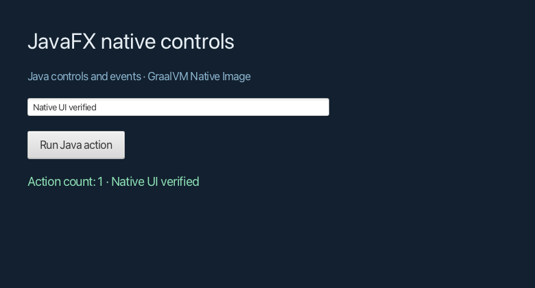

# JavaFX 原生控件 + Native Image：macOS 对照 PoC

**实测可用。** 2026-10-13 在 macOS 27.2 arm64 上，使用 JavaFX 25.0.2 与标准
GraalVM CE/JDK 25.0.2，实际构建并运行了 Stage、VBox、Label、TextField、Button 界面。
按钮事件在 JavaFX UI 线程执行 Java 代码并更新控件，截图完成后正常关闭、进程退出 0。
将单个可执行文件搬到隔离目录、移除 Java 环境变量后同样通过；vmmap 中没有 WebKit、
JVM 或安装的 JDK 库。[实际运行日志](evidence/native-run.log)

这里的“原生 UI”是 JavaFX 控件与场景图，由 JavaFX 渲染系统绘制，不表示每个控件
映射为 AppKit 的系统控件。业务交互直接使用 Java 事件处理，不经过 HTML/JavaScript。

本项目只依赖 `org.openjfx:javafx-controls:25.0.2:mac-aarch64`，传递依赖只有 JavaFX
graphics/base。没有 WebView、WebKit、媒体或 JavaScript 模块，也没有 Gluon/Substrate
构建工具。项目独立于根 reactor 和现有框架。

## 适配条件与范围

- 复用 WebView PoC 已验证的 47 行 macOS 首线程 CoreFoundation/FFM 启动器，以及 Glass
  JNI 生命周期回调和 FFM 配置。本目录保留独立副本，不依赖兄弟实验的源码或 JAR。
- JVM 实际运行采集的反射/JNI/资源配置用于 Native Image 构建。
- **不需要 WebView PoC 的 WebKit 库补丁，JavaFX 原生库使用 Maven 下载的原件。**
- 成功路径没有调用 `System.exit(0)`；JavaFX 停止并返回 launcher 后自然退出。
- 按钮用 `Button.fire()` 验证 ActionEvent，文本框用 Java API 更新，未用桌面 UI 工具
  验证真实键鼠输入。关闭测试走 `WINDOW_CLOSE_REQUEST` 和 `Stage.close()`。
- FXML、其他控件、第三方 UI 库、具名模块、长期稳定性及 Windows 未验证。
- 本机仍安装了 JDK，隔离启动证明没有加载它的运行库；全新未安装 JDK 的机器尚未验证。
- classpath 运行的 `Unsupported JavaFX configuration` 警告保留在日志中；本轮实测不代表
  上游承诺支持所有应用组合。

## 复现

需要 macOS arm64、GraalVM CE 25.0.2、Maven 和 CommandLineTools。Maven 本地缓存复用
兄弟实验的 `target/maven-repository` 路径，仅用于减少下载，空缓存也可自行下载依赖。

```sh
cd experiments/javafx-native-ui
export POC_JDK_HOME=/path/to/graalvm-ce-25.0.2/Contents/Home
export JAVA_HOME="$POC_JDK_HOME"
./compile.sh
./run-jvm.sh
./build-native.sh
python3 verify-native.py
```

Native Image 使用 `--no-fallback`，JavaFX/Glass/Prism 相关类在运行期初始化。配置分为
[本次执行采集的 metadata](config/observed-reachability-metadata.json) 与
[启动/JNI 补充](src/main/resources/META-INF/native-image/poc/bootstrap/reachability-metadata.json)。
前者可审查，本地构建使用 `run-jvm.sh` 新生成的 `target/native-config`。

## 和 WebView PoC 的区别

两项实验使用相同的 JavaFX/GraalVM 版本、OS 和原生构建模式；界面工作负载不同，下面
只比较技术组成和两个样例的实际分发文件，不是性能 Benchmark。

| 项目 | JavaFX WebView PoC | JavaFX 原生控件 PoC |
| --- | --- | --- |
| UI 表达 | HTML/CSS/JavaScript | JavaFX Node、布局和控件；本例用 Java 创建 |
| Java 业务调用 | Java ↔ JavaScript Bridge | 直接 Java 事件处理 |
| 浏览器引擎 | 随文件嵌入 JavaFX WebKit | 无 |
| macOS Native Image 启动适配 | 需要 | 需要同一启动适配 |
| 原生库补丁 | 本例需要 WebKit 依赖加载补丁 | 不需要 |
| 本机实际窗口/交互/退出 | 通过 | 通过 |
| 可执行文件 | 163,571,712 bytes，约 156 MiB | 40,503,472 bytes，约 39 MiB |

原生控件样例最后一次 Native Image 构建报告 26.6s，脚本 wall time 28.90s。这是单次
PoC 记录，不能作为构建速度、启动速度或内存优劣的统计结论。

**如果产品改用 JavaFX 控件构建 UI，这条 Native Image 路线在本机已实际可用，而且
本例消除了 WebKit 分发与补丁问题。** 但它不能直接承接当前 HTML 前端，改用这条路线
需要重写界面；继续保留 HTML 前端仍属于 WebView 路线。



完整库映射压缩在 [原始 vmmap](evidence/loaded-libraries.txt.gz)，
[可读摘录](evidence/loaded-libraries.txt) 附原始 SHA256。
[manifest](evidence/manifest.json) 保存原生文件版本、大小、SHA256 和验收范围。
[构建日志](evidence/native-build.log)、[JVM 对照](evidence/jvm-run.log)均保留。
