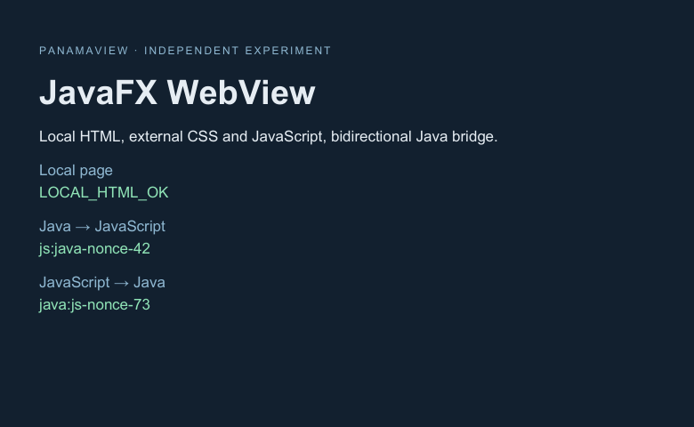

# macOS JavaFX WebView Native Image PoC

实测日期：2026-10-13。独立构建项目，不依赖 panamaview，不加入根 Maven reactor。

另有 [JavaFX 原生控件 Native Image 对照 PoC](../javafx-native-ui/README.md)，验证不使用
WebView 的 Label/Button/TextField 界面；本文件的补丁结论限于 WebView 实验。

**已在本机实际运行 GraalVM Native Image：窗口、本地 HTML/CSS/JS、双向 Bridge、页面
渲染、资源清理和正常进程退出均通过。** 原生文件单独搬到隔离目录、移除 Java/GraalVM
环境变量后也通过；运行时映射中有 JavaFX WebKit，没有 `libjvm.dylib` 或安装的 JDK 库。

这是**有适配条件的原生 PoC**。未经处理的标准 JavaFX 工件没有直接通过，需要：

1. 47 行 macOS CoreFoundation/FFM 启动适配，确保 OS 首线程运行事件循环。
2. 明确的 Glass JNI 生命周期回调配置，加上实际 JVM 执行生成的反射/JNI/资源元数据。
3. 对一份复制的 `libjfxwebkit.dylib` 做实验性补丁：把无对应 JVM 符号导入的
   `@rpath/libjvm.dylib` 强制加载改为弱加载，然后重新做本地 ad-hoc 签名。

JavaFX 的 Java 类和 WebView/Bridge API 未被替换；没有使用 Gluon/Substrate 构建插件、
专用 GraalVM、JDK17 或 JVM fallback。补丁是本次受控实验的结果，不是上游支持承诺。
未验证全新、物理上没有安装 JDK 的 Mac，也没有进行性能 Benchmark、长期稳定性、
多次页面创建销毁、签名公证或其他 macOS 版本验证。

## 环境

| 项目 | 本次实际版本 |
| --- | --- |
| 系统 | macOS 27.2，build 26B5101f，arm64 |
| JDK / GraalVM | GraalVM CE 25.0.2+10.1，OpenJDK 25.0.2+10 |
| Native Image | 25.0.2，Serial GC，`--no-fallback` |
| JavaFX | Maven `org.openjfx:javafx-web:25.0.2:mac-aarch64`，运行时 25.0.2+4 |
| 构建工具 | Maven 3.10.0，compiler plugin 3.13.0，dependency plugin 3.8.1 |
| C 工具链 | Apple clang 17.0.0，CommandLineTools，arm64-apple-darwin27.2.0 |
| 原生程序 | Mach-O arm64，163,571,712 bytes，约 156 MiB；必要原生库和页面嵌在文件内 |
| 最后一次构建 | Native Image 报告 29.8s；构建脚本 wall time 32.78s，单次记录，非 Benchmark |

版本和原生文件/补丁库的 SHA256 见 [manifest](evidence/manifest.json)。整个依赖树记录在
生成的 `target/classpath.txt`；下载和构建缓存放在本项目 `target/` 下。

## 复现

需要 macOS arm64、完整 GraalVM CE 25.0.2（含 Native Image）、Maven 和 Apple
CommandLineTools。PoC 会实际显示窗口并自动关闭；每次启动使用唯一临时资源目录。

```sh
cd experiments/javafx-webview-native-image
export POC_JDK_HOME=/path/to/graalvm-ce-25.0.2/Contents/Home
export JAVA_HOME="$POC_JDK_HOME"

./compile.sh
python3 verify-run.py --log target/jvm-run.log -- ./run-jvm.sh

# 明确启用实验库补丁。下载的 Maven 原件和已安装的 JDK 均不被修改。
POC_PATCH_WEBKIT=1 ./build-native.sh

python3 verify-run.py --log target/native-run.log -- \
  target/dist/javafx-webview-poc \
  -Djavafx.cachedir="$PWD/target/native-cache" \
  -Dpoc.snapshot="$PWD/target/native.ppm"

# 仅复制可执行文件，在独立 cwd、最小环境中运行，并检查该进程的 vmmap。
python3 verify-standalone.py
```

`run-jvm.sh` 用 Native Image tracing agent 生成 `target/native-config`。本次实际使用的
配置另存为 [observed metadata](config/observed-reachability-metadata.json)，可用于审查
与固定版本重建；它只覆盖本次执行路径，不是全部 JavaFX 功能的通用配置。
`build-native.sh` 默认不启用原生库补丁，方便重现未经修正的库依赖问题。使用
`-Dpoc.bootstrap=direct` 可以绕过启动适配、重现最初的首线程挂起。

## 验收记录

| 检查 | JVM 对照 | 最终 Native Image |
| --- | --- | --- |
| Stage / WebView 实际启动 | 通过 | 通过 |
| 本地 HTML 唯一标记 | 通过 | 通过 |
| 外部 CSS / JavaScript 加载 | 通过 | 通过 |
| Java → JavaScript 返回值和 DOM 状态 | 通过 | 通过 |
| JavaScript → Java 回调次数与返回值 | 通过 | 通过 |
| 页面实际渲染和像素截图 | 通过 | 通过 |
| 关闭请求、Application.stop、临时资源删除 | 通过 | 通过 |
| Application.launch 返回、无强制成功退出、进程 exit 0 | 通过 | 通过 |
| 单文件迁移、无 Java 环境变量和原路径资源启动 | 不适用 | 通过 |
| vmmap 中 WebKit 已加载、JVM/JDK 库未加载 | 不适用 | 通过 |
| 全新、未安装 JDK/JVM 的另一台 Mac | 不适用 | 未验证 |

关闭测试由 JavaFX `WINDOW_CLOSE_REQUEST` 和 `Stage.close()` 驱动，未用桌面 UI 工具点击
窗口按钮。成功路径不调用 `System.exit(0)`；外部测试器有截止时间，因此退出挂起不能
靠日志中的 PASS 掩盖。

本轮只验证一个公开 Java bridge 的字符串调用和基本本地页面。具名模块、其他返回类型、
异步业务调度、导航后的桥对象生命周期、ES modules/fetch/Worker 等尚未验证。



## 实际遇到的问题与修正

| 实验步骤 | 实际运行结果 | 修正与证据 |
| --- | --- | --- |
| 普通 `Application.launch` + 直接 Native Image | 45s 后仍未进入 `Application.start`，测试器结束进程 | 主线程等待，JavaFX launcher 等待 Glass 启动；[超时日志](evidence/native-direct-timeout.log)、[线程采样](evidence/native-thread-sample.txt) |
| 加入首线程 CoreFoundation 事件循环 | 进入 start，但 WebKit 库无法加载；异常退出时还缺 JNI 方法并崩溃 | `otool -L` 与动态加载诊断定位必需 `libjvm.dylib`；Glass `notifyWillHide()` 等需要补登记；[日志](evidence/native-bootstrap-failure.log) |
| 加入 WebKit 库补丁与 Glass JNI 配置 | 页面和双向 Bridge 成功，清理成功，进程仍不退出 | Glass 关闭后外层 `CFRunLoopRun` 仍运行；[日志](evidence/native-close-timeout.log)、[关闭后线程采样](evidence/native-close-thread-sample.txt) |
| 改为有界 `CFRunLoopRunInMode`，等待 launcher 完成 | 全部功能和正常退出通过 | [最终构建](evidence/native-build.log)、[隔离原生运行](evidence/standalone-run.log)、[独立启动总结](evidence/standalone-summary.txt) |

tracing agent 在 JVM bridge 路径报告过 `Trampoline.class` 资源记录处理错误。JVM 和最终
原生程序的同一路径均实测通过，因此保留警告并记录，未把 tracing agent 的输出视为
完整性保证。classpath 模式也会报告 `Unsupported JavaFX configuration`；本轮运行已验证，
但命名模块模式和上游支持范围未验证。[JVM 完整日志](evidence/jvm-run.log)

[启动适配](src/main/java/poc/MacNativeBootstrap.java)仅调用 CoreFoundation 的主 run loop，
不自行创建窗口或调用 WKWebView。[补丁脚本](patch-webkit.py)先检查 CPU 架构和 JVM 符号
导入，再只改变指定加载命令、重新签名并复制到新 JAR。即使当前没有 JVM 符号导入，
也不证明未来版本或其他 WebKit 功能不需要该依赖，故补丁不能未经审查推广到其他版本。

JNI 补充和 FFM 描述符在
[bootstrap metadata](src/main/resources/META-INF/native-image/poc/bootstrap/reachability-metadata.json)。
资源、反射和 JNI 的 observed metadata 包括桥对象 `poc.WebViewPoc$Bridge.echo(String)`、
实际执行的 JavaFX 类，以及四个原生库。构建另外显式包含 `web/.*`，所有 JavaFX/Glass/
WebKit 等相关包延迟到运行期初始化。

## 对现有 FFM + WKWebView 的意义

| 方面 | 现有 macOS FFM + WKWebView | 本次 JavaFX 原生候选 |
| --- | --- | --- |
| 窗口与 WebView | 仓库已有可用实现 | 本机实际走通 |
| 窗口、事件与 Bridge API | 项目自己封装 AppKit/WKWebView | JavaFX Stage/WebView/JSObject 提供基础 API |
| Native Image 适配 | 项目已有 FFM metadata | 仍需 macOS 启动适配、JNI/反射 metadata 和库补丁 |
| 渲染引擎分发 | macOS 提供 WKWebView 引擎 | 本次可执行文件嵌入 JavaFX WebKit 原生库 |
| 更新责任 | 跟随 OS 引擎与本项目绑定实现 | 跟随 JavaFX/GraalVM，当前还要维护实验补丁与 metadata |
| 长期稳定性与总性能 | 仍须进一步验证 | 本 PoC 未验证，不能认为已优于现有实现 |

**macOS 上的 JavaFX WebView Native Image 技术可行性已获得本机运行证据，但这是需要
额外适配的候选。它尚未证明“更省维护”或“更轻量”，现有架构继续作为基准。** 是否
进入统一 Benchmark，应结合这几个实际适配成本和分发体积决定；本轮没有用单次构建
记录或日志推断性能优劣，也没有扩大到 Windows。

原生库映射和线程采样的完整原始文件以 `.gz` 保存，旁边 `.txt` 是摘录与原始 SHA256。
已生成的二进制在 `target/dist/javafx-webview-poc`，未提交第三方二进制或构建产物。
