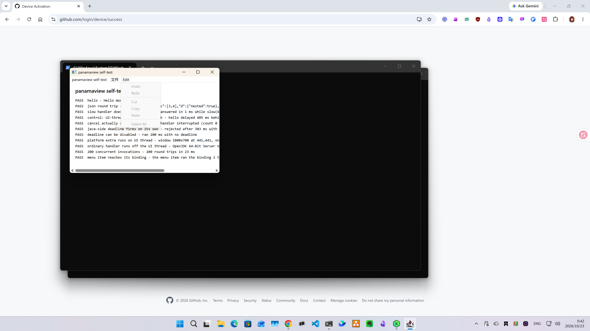
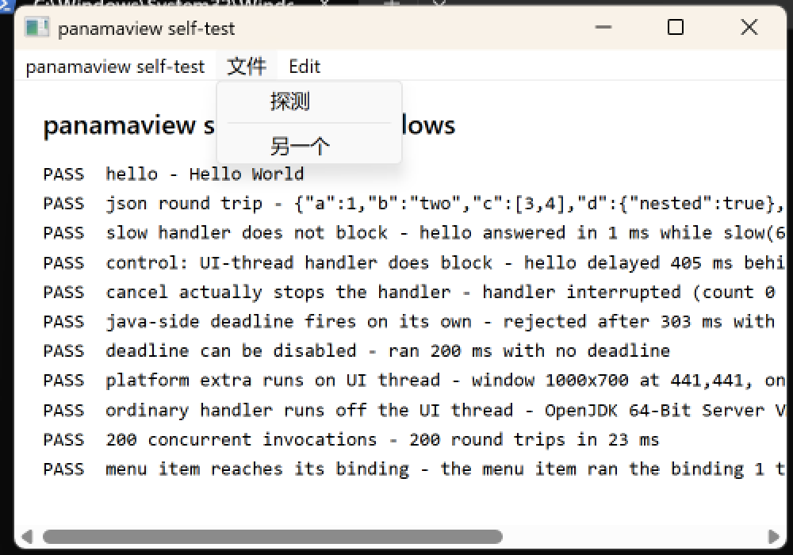

# windows-probe

The Windows port's milestone-1 consumer. It proves the FFM → `WebView2Loader.dll` → installed
runtime chain without opening a window, so it runs over SSH, in session 0, on a headless
runner — anywhere a JVM runs.

It exists for the same reason `demo-app/` does: the framework jar must carry no application,
so anything with a `main()` lives in a module that depends on the framework the way anyone else
would. Like `demo-app/`, it is a module of the repository's reactor — it resolves the framework
out of the local repository rather than out of the reactor, and inherits the version instead of
pinning it.

It builds on any platform. `Win32`, `Com` and `WebView2` bind their entry points at run time
through `Linker.nativeLinker()`, so on macOS they compile and are never called; only running the
probe on Windows reaches the loader. That is what makes it usable as a compile-time check
everywhere and a real check on Windows.

The probe stops at the runtime version on purpose: opening a window is milestone 2, which needs a
desktop session — not because the code is missing, but because Windows does not render one to a
headless session.

## Run it

```sh
mvn install -DskipTests                                  # the framework, once, from the repository root
powershell -ExecutionPolicy Bypass -File fetch-loader.ps1
mvn compile exec:exec
```

Expected output ends:

```
loader  ...\windows-probe\loader\WebView2Loader.dll
runtime WebView2 154.0.4258.62
[probe] PASS — FFM reached the loader, and the installed runtime answered
```

Exit codes: 0 pass, 1 the runtime chain failed, 2 the loader DLL is not staged.

## The bridge self-test

The macOS side has had a self-test since the beginning: the demo application runs thirteen
checks in a real window and hands the verdict to Java, so the result lands in stdout where a
machine can read it. Windows had nothing equivalent — `WindowsDemo` is an interactive demo with
buttons, which proves the same things to a person watching the screen and to nobody else.

That is not a cosmetic difference. The demo runs on macOS, and the portable half of the
framework behaves the same way on both platforms — so a bug that only shows up on Windows has
nowhere to show up. One did: live reload silently did nothing on Windows, because the watcher
was only registered when the caller happened to be on the UI thread, and on Windows that is
never true at the moment the watcher is registered. The macOS self-test could not have caught
it, and the Windows probe had no equivalent to catch it with.

`WindowsSelfTest` is that equivalent. It runs the same checks, minus the two that are
macOS-only — a by-value `NSRect` round trip, which is AppKit's ABI and means nothing here, and
a programmatic resize, which Windows has no binding for yet. A check that cannot fail is not a
check, so neither is faked.

```bat
run-selftest.cmd
```

Expected output ends:

```
[selftest] 11 passed, 0 failed
[selftest]   PASS  hello - Hello World
[selftest]   PASS  json round trip - {"a":1,"b":"two","c":[3,4],"d":{"nested":true},"e":null}
[selftest]   PASS  slow handler does not block - hello answered in 1 ms while slow(600 ms) was in flight
[selftest]   PASS  control: UI-thread handler does block - hello delayed 405 ms behind slowUi(400 ms)
[selftest]   PASS  cancel actually stops the handler - handler interrupted (count 0 -> 1); page stopped waiting in 0 ms
[selftest]   PASS  java-side deadline fires on its own - rejected after 303 ms with "no answer within 300 ms"
[selftest]   PASS  deadline can be disabled - ran 200 ms with no deadline
[selftest]   PASS  platform extra runs on UI thread - window 1000x700 at 441,441, onUiThread=true
[selftest]   PASS  ordinary handler runs off the UI thread - OpenJDK 64-Bit Server VM, handler on VirtualThread
[selftest]   PASS  200 concurrent invocations - 200 round trips in 23 ms
[selftest]   PASS  menu item reaches its binding - the menu item ran the binding 1 time(s), and the one after the separator 1
[selftest] the screenshot: the menu item '文件' is at 708,499 78x38
[selftest] the screenshot is at selftest-window.png (1920x1080)
[selftest] the screenshot: the menu item 'Edit' is at 786,499 68x38
[selftest] the second screenshot is at selftest-window-edit.png (1920x1080)
[selftest] DONE
```

That block is one run — the run the screenshots beside it came from. Two of its numbers are
Windows' to choose rather than the test's: the window's **position**, which `CW_USEDEFAULT`
places where it likes and which moved on every run of that box (49,49 / 98,98 / 196,196 /
245,245 / 294,294 / 392,392 / 441,441), and the milliseconds, which are the machine's. The
verdict is the same either way: eleven passed, none failed, and the exit code 0.

**One line in the run's output is not the test's, and it is not a failure.** Chromium's own
teardown says:

```
[1023/004218.638:ERROR:ui\gfx\win\window_impl.cc:172] Failed to unregister class Chrome_WidgetWin_0. Error = 1411
```

It comes after the verdict and after the exit code, and PowerShell renders a native command's
stderr as an error, so a reader — or a log parser — can take it for one. It is the browser
tidying up after the window closed, and it is what the run has always ended with.

The two lines worth reading together are the slow-handler pair. The same work, the same
duration, on two different threads: **1 ms** on a virtual thread, **405 ms** on the UI thread.
That difference is the whole threading contract, measured.

The eleventh check is the menu, and it is the one this platform owes the other one. The
application declares a bar with a binding item in it, the test clicks that item, and the
binding's effect is what the check asserts — a counter that has not moved says the click went
nowhere, and a click that goes nowhere does not throw, it does nothing, silently. The wait for
the effect lives in the binding rather than in the page, because the click crosses three hops
before it lands: the message to the window, the pump thread's `WM_COMMAND` handling, and the
binding on a virtual thread.

**Two items are clicked, not one**, and the second is the one *after* the separator. The
model numbers the separator too, so the item after it does not shift, and the native menu
reports 0 for a separator — so an off-by-one in the id mapping would send the second click to
the wrong item, silently, which is what this check exists to rule out. Both counters are
asserted, in one check: the first item's and the second's.

**The bar carries the framework's Edit menu too, and its items are disabled.** Windows has no
route for the editing commands — the browser performs them itself — so every item in that menu
is built greyed out, and the framework says so on stderr:

```
[panamaview] these menu operations have no Windows route, so their items are disabled: [UNDO, REDO, CUT, COPY, PASTE, SELECT_ALL]
```

That line is the evidence, and it is in the run's output because the self-test declares the
Edit menu: the disabled path was otherwise covered only by a unit test on a machine that
cannot load `user32.dll` at all.

A **watchdog** stands behind the verdict. The exit code belongs to the application, and a
failure before the window exists — a menu whose titles do not match the model is refused at
start-up — leaves the page with nothing to report, so the process would sit there and exit 0:
loud on stderr, and a pass to anything reading the exit code. If the page has not reported
within a minute, the self-test says so and exits non-zero.

The verdict is in the log; the screenshots are the evidence that something was actually
drawn. The first is a real Windows 11 desktop, the app window, the eleven PASS lines on the
page, and the framework's Edit menu open with its items greyed out — the editing commands
Windows has no route for, built and not choosable:



The second is the same window a moment earlier, with the application's own 文件 menu open and
its binding item 探测 in it — the one thing the log cannot show:



That box's display runs at 200% scaling, so a capture is the desktop at half its size: the
window is 1000×700 in the pixels the framework asked for and 500×350 in the picture. The
menu item's rectangle in the log is in physical pixels too — `GetMenuItemRect` answers in
Win32's own coordinates — so `at 708,499 78x38` is at `354,249 39x19` in the picture. The
second picture is that same window magnified twice, which is what the menu looks like at the
size a person at the keyboard sees it: the application's own menu, its binding item 探测 in
it, and the Chinese titles as characters rather than as mojibake.

It opens a window, so like the smoke it needs an interactive session — see the next section for
running it from SSH.

## The smoke (milestone 2a)

`Smoke.java` is the first real window: it creates a Win32 window, a WebView2 environment
and controller over it, navigates the page, and runs `2+2` through `ExecuteScript` with a
hand-built COM callback — the whole sequence milestone 2 will grow `WindowsHost` out of,
with no framework around it yet.

It opens a window on the desktop it runs in, so it must be launched from an **interactive
session** (RDP or the console), not SSH — in session 0 WebView2 does not run. It ends by
itself (a watchdog quits it after four minutes if the chain stalls), and every stage lands
in `smoke-result.txt` beside this file, so the run can be judged by someone who was not
watching the screen:

```bat
run-smoke.cmd
```

Expected last stage: `stage script  2+2 returned 4` and a PASS verdict line.

### Running it from SSH

`run-smoke.cmd` needs an interactive session, and an SSH connection is session 0 — so from a
terminal on another machine the smoke looks like it cannot run at all, and the failure is WebView2's
`0x80070578`, which names nothing about sessions.

`run-in-session.ps1` is the way in: it registers a scheduled task with `-LogonType Interactive`,
which makes Windows run it in the logged-on user's session rather than the one the connection
created, and returns the wrapped script's exit code.

```powershell
# from the SSH session
.\run-in-session.ps1 -File .\smoke-wrapper.ps1 -TimeoutSeconds 300
```

The self-test is delivered the same way:

```powershell
.\run-in-session.ps1 -File .\run-selftest.ps1 -TimeoutSeconds 180
```

The session id is deliberately not a parameter: it changes with how the user connected — measured on
one machine, `console` was session 1 with nobody at the keyboard and session 2 once an RDP connection
took session 1. Wrap what you want to run in a script, and its output is returned here and left in
`<script>.session.log` beside it.

Exit codes: the wrapped script's own, or `2` if it was still running at the timeout — in which case
the task and the process it started are stopped, because an unregistered task cannot stop what it
started and the window would stay on the user's screen.

## Requirements

- Windows on x64, with the WebView2 Evergreen runtime installed. It is preinstalled on
  Windows 11; the probe names it explicitly when it is missing. `fetch-loader.ps1` does not
  install the runtime — it fetches the loader that finds it.
- JDK 25 and Maven. `mvn.cmd` takes its Java from `JAVA_HOME`, so a machine with several JDKs
  points that at the JDK 25 install and the build follows it; nothing else needs configuring.

The loader DLL is not committed. `fetch-loader.ps1` downloads it from the
`Microsoft.Web.WebView2` NuGet package and verifies its sha256 against the pin in the script —
the same pattern as the Tailwind standalone binary in the `vanilla-tailwind` template.
